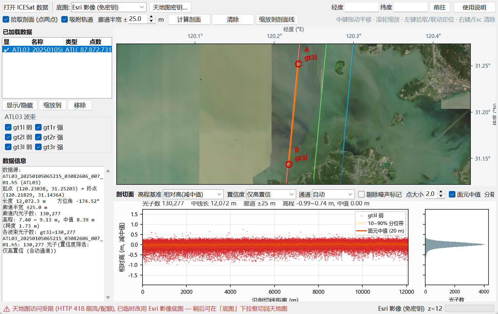

# ICESat 光子剖面查看器 (天地图底图 · 两点连线剖切)

一个基于 Python + tkinter/matplotlib 的桌面可视化程序:

* **天地图**（矢量 / 影像 / 地形，含注记层）作为底图，未配置密钥时自动回退到免密钥备用底图；
* 用"文件 → 打开"加载 **ICESat-2 ATL03**（也支持 ATL06/ATL08、ICESat/GLAS GLAH14、CSV/TXT、LAS/LAZ）；
* 在 ICESat 覆盖区域内**任意点击两点**，立即给出该直线下方廊道内的**光子剖切面**
  （沿剖切线距离 – 高程散点 + 高程直方图 + 面元中值/分位带）；
* 全程窗体化：菜单、工具栏、数据面板、地图画布、剖面面板、状态栏。



> 上图：两个拾取点自动吸附到 `gt3l` 轨道，视野已框到 A→B 剖切线，
> 右下方为太湖水面光子剖面（130,277 个光子）。这一张截图拍摄时天地图接口正被限流
> （HTTP 418），程序按设计**自动临时降级到 Esri 影像**并在状态栏用红色提示，
> 不弹窗、不影响任何剖面功能。

---

## 1. 快速开始

```bat
:: 方式一: 双击运行 (脚本已指向 conda 环境 waterenv)
run.bat

:: 方式二: 指定解释器
C:\Users\ASUS\miniconda3\envs\waterenv\python.exe main.py

:: 打开时直接载入数据
run.bat --open "D:\Paper\Data\satellite image\ICESAT\Taihu\ATL03_20250105065215_03082606_007_01.h5"

:: 没有 ICESat 数据? 生成一份合成演示数据并打开
run.bat --demo
```

依赖已由 `waterenv` 环境提供（numpy / matplotlib / h5py / Pillow / requests / pyproj / scipy / pandas）。
如需在新环境安装：`python -m pip install -r requirements.txt`。

### 天地图密钥（tk）

**项目已预置一枚可用密钥**（`46921bcb…bbdf`，写在 `config.json` 与
`icesat_viewer/settings.py:PROJECT_TIANDITU_TOKEN`），开箱即用，启动时会自动在线校验。

换成自己的密钥有三种方式，优先级从高到低：

1. 环境变量：`set TIANDITU_TK=你的密钥`
2. **界面内配置**：工具栏 **「天地图密钥…」** 按钮（或 工具 → 天地图密钥 / 底图设置…）
   —— 可显示/隐藏密钥、实时校验格式、**校验密钥**（在线）、**清除**、**仅保存**、**校验并保存**；
   免费申请：<https://console.tianditu.gov.cn/api/key>
3. 命令行：`run.bat --token 你的密钥`

> **无效密钥会抛异常，不会静默降级**：密钥缺失、格式错误（非 32 位十六进制）、
> 或被服务端拒绝（HTTP 401/403）时，底图引擎抛出 `TiandituTokenError`；
> 主动校验接口：`TileEngine.validate_provider(...)`（强制联网，缓存不会掩盖失效密钥）。
> 只有"完全没有配置密钥"时才会自动回退到免密钥备用底图（Esri 影像）。

**异常绝不弹窗打断你**：底图/密钥类错误只写状态栏（红色 ⚠ 提示），
不再自动弹出模态对话框。要看完整异常时点 **工具 → 底图错误详情**，
或主动点密钥窗口里的"校验密钥"（这条才弹框，因为是你主动触发的）。

天地图返回 **HTTP 418** 表示**限流 / 配额用尽**（不是密钥失效）。程序会：
① 抛 `TiandituQuotaError`（与"密钥无效"明确区分）；
② 自动临时切到 Esri 影像，保证你还能继续看图；
③ 该降级只作用于本次会话，下次启动仍优先尝试天地图。

---

## 2. 使用流程

| 步骤 | 操作 |
| --- | --- |
| 1 | **文件 → 打开 ICESat 数据 (Ctrl+O)**，选择 `.h5`（可多选，多个文件可叠加比较） |
| 2 | 地图上出现 6 个波束的彩色轨迹线 —— 那就是 ICESat 覆盖区域 |
| 3 | 勾选工具栏 **"拾取剖面 (点两点)"**（Ctrl+P），在轨迹附近点击 **A 点** |
| 4 | 点会**自动吸附到最近的轨道点**（状态栏提示吸附到的波束与偏移量；灰 × 是原始点击位置，虚线连着吸附后的取点），移动鼠标可见预览连线 |
| 5 | 点击 **B 点** —— 若 A 已吸附到某波束，B 会**优先吸附到同一条轨道**（容差放宽 3 倍），随后自动提取廊道光子并绘制剖切面 |
| 6 | 确定直线后视野**自动框到这条 A→B 剖切线**上；工具栏按钮随之变为 **"缩放到剖面线"**，平移/缩小后点它（或 Ctrl+D、双击地图）即可随时回到该直线；清除拾取后恢复为"缩放到数据" |
| 7 | **联动定位**：浏览模式下点地图轨迹 → 剖面上出现红色竖线+亮点；点剖面任意位置 → 地图立刻 zoom 过去（两侧同时高亮） |
| 8 | 右下面板查看剖面；调整廊道半宽 / 置信度 / 高程基准会**自动重算** |
| 9 | **文件 → 导出剖面数据 (CSV)** / 导出剖面图、地图视图 (PNG) |

地图操作：

| 鼠标 | 功能 |
| --- | --- |
| **中键拖动** | 平移底图 |
| **滚轮** | 以光标为中心缩放 |
| **左键单击** | 拾取剖面点（拾取模式下，自动吸附到轨道） |
| **左键双击** | 缩放：已确定剖切线时缩放到该直线，否则缩放到数据范围 |
| **右键 / Esc** | 清除拾取 |

工具栏右侧"定位"框可输入经纬度直接跳转；状态栏实时显示操作提示、光标经纬度、
底图级别与瓦片状态、剖面统计。

吸附容差 = 25 像素对应的地面距离（随缩放自适应，限幅 15 m ~ 5 km），
工具栏 **"吸附轨道"** 复选框可随时开关（关闭后使用鼠标原始点击位置）。

---

## 3. 支持的 ICESat 数据

| 产品 | 格式 | 读取方式 |
| --- | --- | --- |
| **ATL03**（ICESat-2 光子） | `.h5` | **惰性分块读取**：先用 geolocation 段索引（`reference_photon_lat/lon` + `ph_index_beg` + `segment_ph_cnt`）建立索引，剖面计算时只读取落在廊道内的那几段光子 |
| ATL06 / ATL08 / ATL13 | `.h5` | 通用 HDF5 读取，自动识别 `latitude/longitude/h_li/h_te_best_fit/ht_ortho…` 字段 |
| GLAH14（ICESat/GLAS） | `.h5` | 读取 `/Data_40HZ/Geolocation/d_lat,d_lon` 与 `Elevation_Surfaces/d_elev` |
| 文本点数据 | `.csv/.txt/.xyz/.dat/.tsv` | 自动识别分隔符与表头，按列名或数值范围判定 lat/lon/elev |
| 点云 | `.las` | 内置纯 Python LAS 解析（含比例/偏移、投影 WKT 自动转经纬度） |
| 点云 | `.laz` | 需 `pip install laspy[lazrs]` |

**实测性能**（太湖 ATL03，2.0 GB，6 波束，87,872,731 个光子）：

* 首次打开并建立索引 **约 1.9 s**（索引缓存到 `~/.icesat_tdt_viewer/index`，再次打开 **0.1 s**）；
* 13 km 长、±25 m 廊道的剖面提取 **约 0.6 s**，返回十万量级光子；
* 覆盖区判定使用 KD 树（`scipy`），鼠标移动时实时显示"距最近轨迹 xx km"。

> 说明：本产品中 `segment_ph_cnt == 0` 的段其 `reference_photon_*` 为无效值（与相邻段相差可达 10 km），
> 程序在轨迹绘制、覆盖判定、廊道选段时均已按光子数过滤，不会出现假轨迹或错误选段。

---

## 4. 剖面参数

| 参数 | 说明 |
| --- | --- |
| **吸附轨道** | 选点自动吸附到最近的 ICESat 轨道点；第二点优先吸附到与第一点相同的波束，使剖面尽量沿轨方向 |
| **确定直线后自动缩放** | 点完两点即把视野框到该剖切线（含廊道宽度）；可在 剖面 菜单里关闭。此后"缩放到数据"按钮自动变为"缩放到剖面线" |
| **廊道半宽 ±m** | 剖切线两侧的采样带宽（默认 25 m）。水面/平坦地表 10~25 m 即可；地形起伏或想纳入更多光子可用 50~200 m |
| **置信度** | 全部 / 中等及以上（`signal_conf_ph ≥ 3`）/ 仅高置信（`= 4`） |
| **通道** | 置信度所属地表类型：自动（取 5 通道最大值）/ 陆地 / 海洋 / 海冰 / 陆地冰 / 内陆水体 |
| **剔除噪声标记** | 剔除 ATL03 `quality_ph ≠ 0` 的光子（afterpulse、脉冲响应等） |
| **高程基准** | 椭球高（WGS84）/ 正交高（减 `geophys_corr/geoid`）/ 相对高（减中值） |
| **面元中值** | 沿迹分箱（默认 20 m）的中值曲线 + 10~90% 分位带 |
| **波束过滤** | 左侧面板可单独勾选 gt1l…gt3r 六个波束 |

太湖示例（ATL03，13 km，±25 m，仅高置信 + 内陆水体通道）：52,636 个光子，
湖面高程 7.58~9.18 m，中值 8.37 m，跨度仅 1.60 m —— 与水面平坦特征一致。

---

## 5. 项目结构

```
icesat_tianditu_viewer/
├── main.py                  程序入口（依赖检查、DPI 适配、命令行参数）
├── run.bat                  Windows 启动脚本（自动定位 waterenv）
├── requirements.txt
├── config.example.json      配置示例（程序运行后生成 config.json）
├── icesat_viewer/
│   ├── app.py               主窗体：菜单/工具栏/数据面板/状态栏、任务线程与事件队列
│   ├── mapview.py           地图画布：瓦片底图、轨迹叠加、平移缩放、两点拾取
│   ├── profileview.py       剖面视图：高程-距离散点 + 高程直方图 + 统计
│   ├── basemap.py           瓦片引擎：天地图 WMTS + 备用底图、内存/磁盘缓存、注记叠加
│   ├── icesat_io.py         ICESat 读取：ATL03 惰性索引、通用 HDF5、CSV、LAS/LAZ
│   ├── corridor.py          两点连线廊道几何与剖面统计（分箱中值、分位、直方图）
│   ├── geo.py               Web Mercator 投影与 WGS84 大地线计算（pyproj，缺失时球面近似）
│   ├── demo_data.py         合成 ATL03 演示数据生成器
│   └── settings.py          配置持久化（tk 密钥、剖面参数、最近文件）
├── tools/make_demo_data.py  命令行生成演示数据
└── tests/
    ├── test_core.py         核心算法测试 (含密钥校验/异常与真实 ATL03 端到端, 可无界面运行)
    ├── gui_smoke.py         界面冒烟测试: 合成鼠标事件→拾取两点→剖面→天地图→密钥异常→截图
    └── final_shot.py        验收截图脚本 (默认配置: 天地图 + 真实太湖数据)
```

关键约定：**地图画布内部统一使用 Web Mercator (EPSG:3857) 米制坐标**（与瓦片底图严格套合），
经纬度只出现在交互与数据层；剖切基准线取两点间的**大地线（测地线）**，
沿迹距离/横向偏距由以起点为中心的方位等距投影给出，数百公里内精度优于 0.1%。

---

## 6. 测试

```bat
:: 核心算法 + 真实 ATL03 端到端（无需界面）
C:\Users\ASUS\miniconda3\envs\waterenv\python.exe tests\test_core.py

:: 界面冒烟测试（会打开窗口、合成真实鼠标事件并截图到 tests\_out）
C:\Users\ASUS\miniconda3\envs\waterenv\python.exe tests\gui_smoke.py
C:\Users\ASUS\miniconda3\envs\waterenv\python.exe tests\gui_smoke.py --demo
```

`gui_smoke.py` 用 `event_generate` 合成真实的 `<Motion>/<ButtonPress-1>/<ButtonRelease-1>/<MouseWheel>`
事件，覆盖"点击拾取两点 → 剖面 / 拖动平移 / 滚轮缩放 / 天地图底图加载 / 无效密钥抛异常"
整条交互链路，并捕获 Tk 回调异常（曾借此发现并修复鼠标事件绑定错误）。

```bat
:: 生成验收截图 (默认配置: 天地图底图 + 真实太湖 ATL03 + 两点剖切)
C:\Users\ASUS\miniconda3\envs\waterenv\python.exe tests\final_shot.py
```

`tests/_out/` 下会生成 `window.png`（整窗截图）、`map.png`、`profile.png`、`profile.csv`。

---

## 7. 常见问题

**底图是灰白格子 / 弹窗提示"天地图密钥无效"** —— 密钥缺失或失效。
点工具栏 **「天地图密钥…」→ 校验密钥** 查看具体异常（`TiandituTokenError` 会带 HTTP 状态码），
换成有效密钥后 **校验并保存** 即可；也可先切到"Esri 影像 (免密钥)"继续用其他功能。

**点击两点后提示"未找到光子"** —— 两点不在 ICESat 覆盖区内（状态栏会提示距最近轨迹多远）。
请放大到彩色轨迹线附近再取点，或加大廊道半宽、把置信度放宽为"全部"。

**剖面里有一大片散点（-150 ~ +150 m）** —— 那是 ATL03 的原始噪声/大气散射光子。
把"置信度"改为"仅高置信"或勾选"剔除噪声标记"即可得到干净的地表/水面剖面。

**为什么不用高德/腾讯底图** —— 它们是 GCJ-02 加密坐标，与 ICESat 的 WGS84 有数百米系统性偏移，
会直接影响剖面定位，因此本程序只提供天地图与 Esri（均为 WGS84 系）。

**LAZ 打不开** —— 需要 `pip install laspy[lazrs]`；`.las` 由内置解析器直接读取，无需额外依赖。

**高分屏字体/图像模糊** —— 程序已做 per-monitor DPI 适配（Tk 缩放 + matplotlib 设备像素比），
若系统缩放中途改变，重启程序即可。

---

## 8. 已知限制

* ATL03 单次剖面默认最多读取 400 万光子，超出会随机抽稀并在剖面标题中标注；CSV 导出为抽稀后的结果。
* 多个数据文件同时显示时，剖面会把各文件的廊道光子合并绘制（按波束/产品着色）。
* 底图注记层（cva_w/cia_w/cta_w）仅在配置了天地图密钥时可用。
